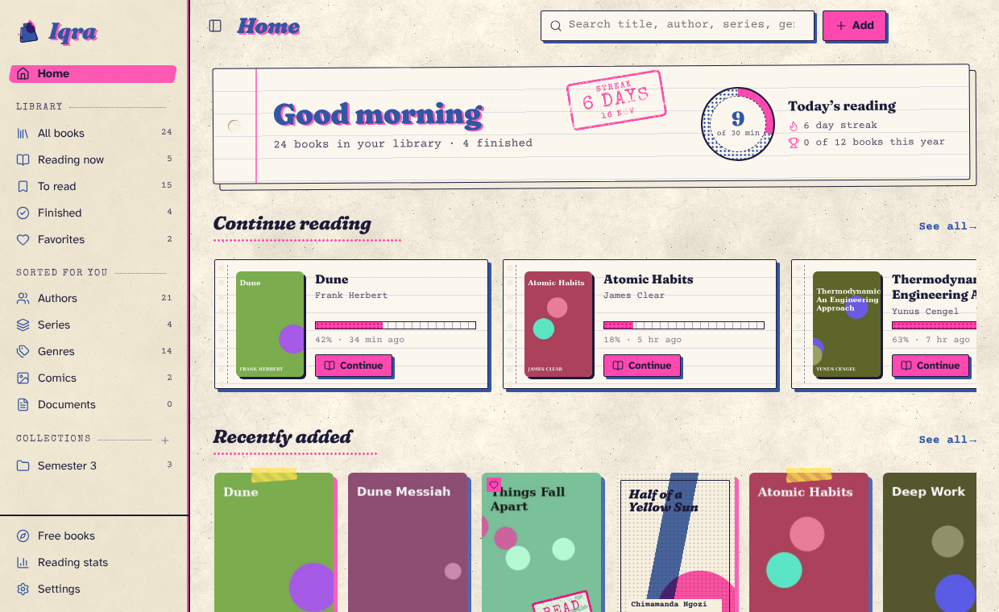

# Iqra



**Iqra** (اقرأ) means *read* in Arabic. It is a book reader and library for Windows that opens almost every ebook and document format, sorts your library for you, and keeps everything on your own computer.

## Features

- **Opens nearly everything**: EPUB, PDF, MOBI, AZW/AZW3, FB2, DjVu, comics (CBZ, CBR, CB7, CBT), and documents (DOCX, DOC, ODT, RTF, TXT, Markdown, HTML).
- **Reads books where they are**: point Iqra at your folders and it finds your books without copying or moving them.
- **Sorts itself**: authors, series (in order), genres and formats are worked out from each file and its filename.
- **Comfortable reading**: paged or scrolling layout, one or two columns, and themes. You can also set fonts (including OpenDyslexic and Atkinson Hyperlegible), spacing and margins, plus a reading ruler and a warmth filter.
- **Tools while reading**: highlights and notes, bookmarks, full-text search, tap-to-define and translate, read-aloud and a word-at-a-time speed reader.
- **Reading stats**: daily goal, streaks, a yearly book goal, and a year-at-a-glance heatmap.
- **Free books**: browse and download public-domain books from inside the app.
- **PDF highlights**: highlight and annotate PDFs (textbooks, lecture notes) the same way as EPUBs. Highlights stay put when you zoom.
- **Arabic and right-to-left books**: Arabic, Persian, Urdu and Hebrew books lay out and turn pages right to left, with the Amiri typeface built in. Any book (manga too) can be switched by hand.
- **Offline dictionary**: English definitions work without internet (WordNet, built in). Other languages still look up online.
- **Review**: turn highlights into spaced-repetition cards with one key word hidden, and export them to Anki.
- **My words**: save words you look up, with the sentence you found them in, then quiz yourself.
- **Want to read**: a list for books you have and books you don't have yet, linked to the free-books page.
- **Quote cards**: turn any passage into a shareable image in seven designs (square, post or story size).
- **Focus & sounds**: timed reading sessions with a chime at the end, and live-generated rain, harmattan wind, ocean waves, fireplace, night train and deep hum.
- **Fourteen looks**: *Riso print* and *Classic*, plus twelve styles with their own paper, type and ornaments: Old Library, Paperback, Broadsheet, Bògòlan, Indigo, Kente, Zellige, Andalus, Manuscript, Rainy window, Night train and Harmattan. Each comes with matching page colors for the reader.

DRM-protected books (for example from the Kindle or Google Play stores) cannot be opened by any third-party reader, including this one.

## Download

Grab the Windows installer from the [Releases](../../releases) page.

Iqra was called Inkwell before version 1.1. If you used Inkwell, Iqra brings across your library, reading positions, highlights, stats and settings automatically the first time it opens.

## Run it from source

Requires [Node.js](https://nodejs.org/).

```bash
npm install
npm start
```

Build the Windows installer (output in `dist/`):

```bash
npm run dist
```

## Where your data lives

`%APPDATA%\Iqra`: the library, settings, highlights and stats as JSON files, plus saved covers. Your book files are never changed.

## Project layout

```
main.js              Electron main process: windows, data files, the app:// protocol, archives
preload.js           The small bridge between the window and the main process
app/
  index.html
  css/app.css        Layout and the Classic look
  css/riso.css       The Riso print look
  css/themes.css     The twelve 1.2 styles (generated)
  js/                Library, reader, sorting, stats, settings (plain JavaScript modules)
  fonts/             Bundled reading and interface fonts (SIL Open Font License / Apache 2.0)
  dict/              Offline English dictionary built from WordNet 3.0 (Princeton WordNet license)
  img/               Logo, paper textures and stamp wear for the Riso look
  vendor/            foliate-js (MIT), PDF.js (Apache 2.0), djvu-rs (MIT), mammoth (BSD), marked (MIT)
```

## License

MIT
